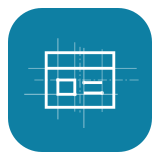
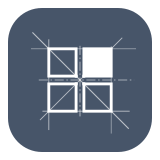

# Laraplate brand assets

Logos for [Laraplate](https://github.com/getlaraplate) and its modules.

| Laraplate | LaraCore | LaraAI | LaraCMS | LaraCRM |
|---|---|---|---|---|
|  |  |  |  |  |

| LaraERP | LaraMES | LaraSAO | LaraShop | LaraEdge |
|---|---|---|---|---|
|  |  |  |  |  |

## Sets

- `logos/blueprint/`: the official set. A white glyph over fine construction lines, on a rounded square in the module colour. `<module>.svg` is the icon, `<module>-full.svg` adds the wordmark.
- `logos/plate/`: a bolder variant of the same icons, meant for small sizes (favicon, sidebar).

Both sets are generated by the `build.mjs` next to them (`node build.mjs`).

## License

The logos are licensed under [CC BY-ND 4.0](LICENSE) (Creative Commons Attribution-NoDerivatives 4.0 International). Copyright (c) 2026 swolley.

You may share them, unmodified, for any purpose, including commercial, with attribution. You may not distribute modified versions.

## Names and trademarks

"Laraplate", "LaraCore", "LaraAI", "LaraCMS", "LaraCRM", "LaraERP", "LaraMES", "LaraSAO", "LaraShop", "LaraEdge" and the logos identify this project. The CC license does not grant any trademark rights. Forks, derivative products and services must not use these names or logos in a way that suggests they are the official project or are affiliated with it.

The code of the Laraplate repositories is licensed separately (AGPL-3.0, see each repository). This license applies only to the files in this repository.

## Using a logo in a README

```html

```
